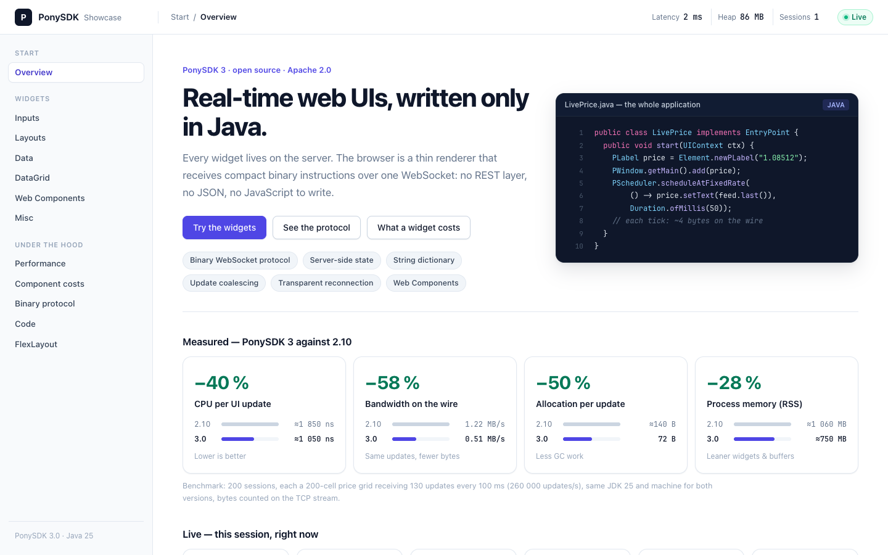

[](https://codecov.io/gh/smartTrade-OpenSource/PonySDK)
[](https://github.com/smartTrade-OpenSource/PonySDK/actions)

# PonySDK

PonySDK is an open source framework for building real-time web applications entirely in Java — no JavaScript required.

It runs a Jetty 12 WebSocket server on the backend and a TypeScript terminal in the browser. Every UI interaction is handled server-side: the browser is a thin rendering layer that receives binary protocol instructions over WebSocket.



---

## Tech Stack

| Component | Version |
|-----------|---------|
| Java (server) | 25 (LTS, virtual threads) |
| TypeScript (terminal) | 7.0, bundled by esbuild 0.28; Node 24 provisioned by Gradle |
| Jetty | 12.1.x (EE11 / Jakarta EE) |
| Spring | 7.x |
| Selenium | 4.x |
| Gradle | 9.x |

---

## Features

**Protocol**
- Binary WebSocket protocol between server and browser
- String Dictionary: up to 83% bandwidth reduction on repeated strings, shared across sessions
- 5-level incremental encoding: equality check → dictionary → merge-patch → binary → WebSocket deflate
- Typed binary arrays: `PAddOn` creation args and method calls carry int/long/double/boolean/String in pure binary, with a uint31 length (no 255-element cap)
- Update coalescing + update runs: only the last value of a property per transaction is sent, and protocol v2 chains
  the updates of a flush into sorted runs (`UPDATE_NEXT` +1 / byte delta / absolute id instead of END + new block)
- Create in parent (protocol v3): a widget whose add directly follows its creation is created inside its parent
  in one block (`[CREATE … PARENT]` instead of `[CREATE …][ADD … PARENT]`), about −19% on the wire when building a page
- Protocol version negotiated per connection (`w` handshake parameter): old terminals keep the v1 format, new
  terminals decode both; `ApplicationConfiguration.setMaxProtocolVersion(1)` forces v1 for everyone

**Connectivity**
- Transparent WebSocket reconnection (opt-in): UIContext survives network drops, state replayed on reconnect
- `RecordingEncoder` buffers all protocol ops during suspension with compaction (merge updates, cancel create+remove pairs)
- Configurable reconnection timeout and buffer limit — safe default is disabled (no silent state resume)
- A server that stops (a deployment, a scale-in, a spot interruption) moves its pages to the other servers first:
  `setDrainMillis`, in waves, each page reloaded where it was; `/health` for the balancer. Behind an ALB on ECS or
  EC2, no shared store ([deployment](docs/guide/deployment.md)). On one machine: `./gradlew :sample:runTwoServers`
- A moved page carries the state its application declares (`uiContext.onMove`), and a form what was typed in it
  (`binder.carry`), sealed with AES-GCM under a key every server shares, through the page itself: no session store
  ([ADR-0018](docs/decisions/0018-state-transfer.md))

**Observability**
- OpenTelemetry instrumentation via `PonySDKMetrics` (OTel API only, SDK goes in your app)
- Metrics: active contexts (gauge), created/destroyed (counters), bytes sent/received, roundtrip latency, execute duration, lock wait (histograms)
- Fully opt-in — no-op when not configured

**Development**
- Debug mode: each element names its Java class and the line that created it (`data-pony="PButton
  InputsPage.java:85"`); an inspector over the page shows the bytes by class and by object, and picks an element
  ([guide](docs/guide/development.md))
- Hot reload: a recompiled screen reloads in the open browser, where it was, without restarting the server
- Spring Boot starter: `ponysdk-spring-boot-starter` registers PonySDK in Boot's own Jetty, `ponysdk.*` properties,
  the drain on graceful shutdown, a health indicator ([guide](docs/guide/spring-boot.md))

**UI**
- Web Component integration (`PWebComponent`) with `PropertyHandle` API (on-heap, off-heap, stateless modes)
- Any DOM event of any widget, listened to by name from Java (`addEventListener("input", PEventOptions.fields(
  "target.value").debounce(...), e -> ...)`): the fields read and the rate limited in the browser (protocol 4,
  [ADR-0003](docs/decisions/0003-protocol-v4-listeners.md))
- `PEventOptions.lock()`: an event sent once until the server answers it, the element `aria-busy` meanwhile, as a
  button's click is by default
- Client commands: `PCommands` (show, hide, toggle, classes, attributes, focus, dispatch) run by the terminal on a DOM
  event, before or instead of the round trip: 0.8 ms to a visible change, against the network's latency
  ([guide](docs/guide/client-commands.md))
- Signals: a value set once from any thread, shown by every widget bound to it, computed values, keyed lists;
  the same bytes on the wire as direct setters ([guide](docs/guide/signals.md))
- Routing: `@Route("orders/:id")` views, typed parameters, guards, access control, on the browser history
  ([guide](docs/guide/routing.md))
- Forms: `Binder` between fields and a bean, converters, validators, Jakarta Bean Validation when present, errors
  read by screen readers ([guide](docs/guide/forms.md))
- Charts: `PChart`, live time series drawn by the terminal from typed arrays, conflated feeds, a 5 KB chunk loaded
  only when a chart exists ([guide](docs/guide/charts.md))
- A default theme: `setTheme("pony")`, CSS tokens, light and dark, WCAG AA contrast ([guide](docs/guide/theme.md))
- i18n: a locale per context from `Accept-Language` or the user's choice, `Messages` from resource bundles,
  locale-aware formats, date names from the browser, right-to-left pages ([guide](docs/guide/i18n.md))
- `PAddOn` for integrating any JavaScript library — typed creation args and method calls sent in pure binary (no JSON) via `PAddOn(Object...)`
- Virtual threads (Java 25) for scalable concurrent `UIContext`s
- TypeScript terminal on native elements and ARIA patterns: keyboard and screen readers, popups in the browser's
  top layer; 27 KB gzipped before the first widget, the rarely shown ones loaded on demand
  ([ADR-0004](docs/decisions/0004-terminal-chunks.md))
- `ListBox` and the dropdowns built in Java say their state to a screen reader too: `listbox` and `option` roles,
  `aria-selected`, `aria-disabled`, `aria-multiselectable`, `aria-expanded` on the button that opens them;
  `DataGrid2` follows the WAI-ARIA grid pattern, one row heard per row, driven from the keyboard
  ([guide](docs/guide/accessibility.md))
- Stylesheets select `pony-<Type>` classes and native or ARIA states; [ADR-0002](docs/decisions/0002-javascript-terminal.md)
  maps each widget to its elements, the guide for stylesheets written on GWT's `gwt-*` classes.
  `ApplicationConfiguration.setLegacyClassNames(true)` adds GWT's class names to the DOM meanwhile

---

## Quick Start

```sh
git clone https://github.com/smartTrade-OpenSource/PonySDK.git
cd PonySDK
./gradlew :sample:runShowcase
```

Then open [http://localhost:8081/sample/](http://localhost:8081/sample/)

The showcase is a tour of the framework: every widget live with the Java
behind it, the measured cost of each component (server memory, bytes to create and update it), a live price ticker
with its encoding pipeline, and the binary protocol streaming typed arrays.

### Your first application

A screen is an `EntryPoint`, run on the server for each browser tab:

```java
public class HelloWorldEntryPoint implements EntryPoint {

    @Override
    public void start(final UIContext uiContext) {
        final PLabel label = Element.newPLabel("Hello PonySDK!");
        final PTextBox name = Element.newPTextBox();
        final PButton button = Element.newPButton("Say hello");
        // Runs on the server: the click comes over the WebSocket, the new text goes back
        button.addClickHandler(event -> label.setText("Hello, " + (name.getText().isBlank() ? "World" : name.getText()) + "!"));

        final PFlowPanel root = Element.newPFlowPanel();
        root.add(label);
        root.add(name);
        root.add(button);
        PWindow.getMain().add(root);
    }
}
```

`./gradlew :sample:runQuickStart` runs it with its server (`sample/src/main/java/com/ponysdk/sample/quickstart/`) on
[http://localhost:8080/hello/](http://localhost:8080/hello/). [The quick start guide](docs/guide/quick-start.md)
gives the dependency and the server code, step by step.

### In another page

A PonySDK application also runs inside a page it does not own, a portal or another web application, as the element
`<pony-app>`:

```html
<script type="module" src="https://fx.example.com/app/ponyterminal/terminal.js"></script>
<pony-app src="https://fx.example.com/app/" view="ticket" instrument="EURUSD">Loading…</pony-app>
```

The server lists the host pages (`ApplicationConfiguration.setWsAllowedOrigins`); the application reads the element's
attributes and exchanges events with the page through `PHost`. The showcase's server also serves a gallery of every
way to integrate on [http://localhost:8082/](http://localhost:8082/).
[The embedding guide](docs/guide/embedding.md) has the details.

### Web components

`PWebComponent` drives any custom element from Java. From a library's Custom Elements Manifest
(`custom-elements.json`), `WebComponentGenerator` writes a typed class per element (`counter.setCount(42)`,
`counter.onCountChanged(…)`): [the web components guide](docs/guide/web-components.md).

---

## Build

```sh
# Compile
./gradlew :ponysdk:compileJava

# Run tests
./gradlew :ponysdk:test

# Terminal: type check, tests on Node, bundle (ponyterminal/terminal.js in the jar)
./gradlew :ponysdk:terminalCheck :ponysdk:terminalTest :ponysdk:terminalBundle

# Full build
./gradlew :ponysdk:build

# Write-path bench: protocol / wire bytes, CPU and allocations per operation, retained heap per widget
./gradlew :ponysdk:bench                      # latest protocol; -Pbench.args="v2" for an older one
./gradlew :ponysdk:bench -Pbench.stats        # + byte breakdown per protocol model
```

---

## Using PonySDK

The [guides](docs/guide/README.md), one per subject:

- [Quick start](docs/guide/quick-start.md): the dependency, a screen, the server.
- [Configuration](docs/guide/configuration.md): `ApplicationConfiguration`, `PonySDKServer`, HTTP compression.
- [Web components](docs/guide/web-components.md), [custom JavaScript](docs/guide/addons.md),
  [EventBus](docs/guide/event-bus.md).
- [Streams](docs/guide/streams.md): values from a feed thread, the latest per key, without waiting for the browser.
- [Embedding in another page](docs/guide/embedding.md) with `<pony-app>`; [FDC3](docs/guide/fdc3.md) with the other
  applications of a trader's desktop.
- [Transparent reconnection](docs/guide/reconnection.md) (opt-in; not for trading screens whose data must not resume
  silently), [security](docs/guide/security.md), [observability](docs/guide/observability.md) (OpenTelemetry metrics).
- [Testing](docs/guide/testing.md): `PSuite`, the Pony driver.
- [Troubleshooting](docs/guide/troubleshooting.md).

---

## Browser Compatibility

| Browser | Min version |
|---------|-------------|
| Chrome | 114+ |
| Firefox | 125+ |
| Safari | 17+ |
| Edge | 114+ |

The terminal uses `<dialog>`, the popover API, `ResizeObserver` and ES2022 modules, without polyfills.

---

## Documentation

- [UPGRADING.md](UPGRADING.md) — from 2.10 to 3.0: platform, removed APIs, the new terminal's DOM, behaviour changes
- [ARCHITECTURE.md](ARCHITECTURE.md) — how it works inside: the protocol, the reconnection engine, the threading model, the design patterns
- [Guides](docs/guide/README.md) — how to use each part: configuration, embedding, web components, reconnection, security, testing
- [Key concepts](ARCHITECTURE.md#4-key-concepts) — Application, UIContext, PObject, the protocol, EventBus, transactions
- [Decisions](docs/decisions/README.md) — the architecture decision records, one per structuring change
- [Wiki](https://github.com/smartTrade-OpenSource/PonySDK/wiki) — FAQ
