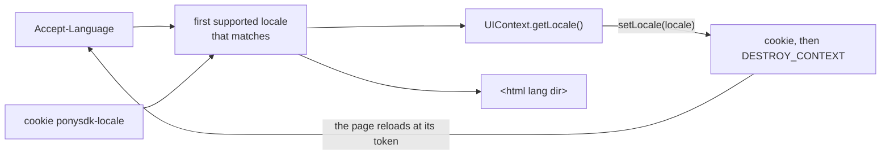

# Internationalisation

An application in several languages: the locale of each page, the texts, the numbers and dates, and the direction of
Arabic and Hebrew. Why it is built so, and what it costs: [ADR-0022](../decisions/0022-locale.md). The showcase's
**i18n** page switches between English, French and Arabic.

```java
configuration.setSupportedLocales(List.of(Locale.UK, Locale.FRENCH, Locale.forLanguageTag("ar"))); // the first is the default

static final Messages MESSAGES = Messages.of("i18n/App");      // i18n/App.properties, App_fr.properties, App_ar.properties

title.setText(MESSAGES.get("order.title", order.id()));        // "Commande 12" for a French visitor
total.setText(Formats.current().currency(order.total(), Currency.getInstance("EUR")));
languageButton.addClickHandler(e -> uiContext.setLocale(Locale.FRENCH)); // keeps the choice, reloads the page
```

## The locale of a page

`ApplicationConfiguration.setSupportedLocales` lists the languages the application is translated in. Without any,
nothing below happens: the contexts have the JVM's locale and no page is touched.

With some, `UIContext.getLocale()` is, in this order:

1. the choice kept in the cookie `ponysdk-locale`, set by `setLocale`;
2. the best match of the browser's `Accept-Language`: `fr-CH` gets `fr`, `de` gets `de-CH` when that is the German
   you support;
3. the first supported locale.

A value that is malformed, or of a language you do not support, is ignored. The same function serves the bootstrap
page: it is sent as `<html lang="fr" dir="ltr">`, so that the first paint is already in the right direction.



## Changing the locale

`uiContext.setLocale(Locale.FRENCH)` takes the supported locale that fits (`fr-CA` gets `fr`; another language
throws `IllegalArgumentException`; an application with no supported locales, `IllegalStateException`), writes the
cookie for a year, and reloads the page at its history token: the screens are built again, in the new locale. On a
local showcase, from the click to the new title takes about 130 ms.

The reload is the whole mechanism: a screen sets its texts when it builds them, and the date picker's names and the
page's direction are set when its widgets are created. What a screen must keep across the switch goes in the token or
in a cookie, as for a server that stops ([deployment](deployment.md)). Setting the locale a context already has does
nothing, so an entry point can set the user's preferred locale at each start; the first visit reloads once.

In an embedded `<pony-app>` ([embedding](embedding.md)) the cookie is the application's origin's: a page of another
site follows the browser's rules for third-party cookies, and the choice survives a reload only where they allow it.

## Texts

`Messages.of("i18n/App", "i18n/Common")` names `ResourceBundle`s; keep one `Messages` per application, not one per
call. The files are UTF-8 properties: `App.properties` is the base (the language you write first), `App_fr.properties`
and `App_fr_CA.properties` refine it.

```properties
# App.properties
order.title=Order {0}
order.count={0,choice,0#no order|1#one order|1<{0} orders}
today=It''s {0}
# App_fr.properties
order.title=Commande {0}
order.count={0,choice,0#aucune commande|1#une commande|1<{0} commandes}
today=C''est {0}
```

- `get(key, args...)` reads the current context's locale; from another thread, `get(uiContext.getLocale(), key, args...)`.
- **The chain.** For `fr_CA`: `App_fr_CA`, `App_fr`, `App`; the bundles you name are searched in order. The JVM's
  default locale is not part of it: a French server shows English, not French, to an Arabic visitor of an application
  that has no Arabic.
- **Arguments.** With arguments the text is a [`MessageFormat`](https://docs.oracle.com/en/java/javase/25/docs/api/java.base/java/text/MessageFormat.html)
  pattern in the locale: `{0,number,#,##0.00}`, `{1,date,long}`, and a quote written twice (`It''s`). Without
  arguments the text is returned as written, quote included, so `It''s` shows two quotes: write it once in a text
  that never has arguments.
- **A plural** is a `choice`: `{0,choice,0#none|1#one|1<{0} many}`. English and French fit (French: `0#...|2#...` makes
  0 and 1 singular). Arabic up to 99 fits as well (`0#...|1#...|2#...|3#...|11#...`); a rule that depends on a modulo
  (Arabic 103 to 110, Polish, Russian) does not: use ICU4J for those texts.
- **A missing key** gives `!order.title!` and one warning in the log per key and locale: the page is never taken down
  by a missing translation, and a test sees the marker. A bundle with no base file fails at `Messages.of`, at startup.
- **A pattern in error** gives its text as written and one error in the log.
- A `MessageFormat` is parsed once per locale and pattern: a text costs 40 to 360 ns.

The framework's own messages (`PString.get("dialog.ok")`, validators, list selectors) are in the same locale, in
English, French and Arabic.

## Numbers and dates

`Formats.current()` writes as the current locale does; `Formats.of(locale)` for another.

| Call | `1234.5` or 29 Oct 2026, in French |
|---|---|
| `number(1234.5)` | `1 234,5` (a narrow no-break space) |
| `percent(0.256)` | `26 %` |
| `currency(1234.5, EUR)` | `1 234,50 €` |
| `date(localDate, FormatStyle.FULL)` | `jeudi 29 octobre 2026` |
| `dateTime(localDateTime, FormatStyle.SHORT)` | `29/10/2026 14:07` |

A `PDateBox` writes and reads its text with a `SimpleDateFormat`. Give it one in the page's locale:

```java
final PDateBox delivery = Element.newPDateBox(Formats.current().dateFormat("d MMMM yyyy")); // "5 mars 2026"
final PDateBox compact = Element.newPDateBox(Formats.current().dateFormat(FormatStyle.SHORT));  // dd/MM/y, M/d/yy...
```

The browser formats the pattern with the names of the page's `lang` and the server reads the text back with the
JDK's: the two agree for the languages the tests compare (French, Arabic). A format built with
`new SimpleDateFormat(pattern)` reads the JVM's names and fails on a French month name in an English JVM. The
digits are 0-9 in the field whatever the language (`dateFormat` asks for `nu-latn`), and an Arabic user's typed
digits (٠-٩) are read.

The date picker and the date box show the names of the page's language, begin the week on its first day (Monday in
France, Saturday in Egypt, where the browser knows: Chromium and Safari; Firefox keeps Monday), and put the weekend
where the locale does. Their button labels stay English.

## Direction

For Arabic, Hebrew, Persian, Urdu and the other right-to-left languages (`Locales.isRightToLeft(locale)`), the page's
root is written `dir="rtl"`, and `lang` with the locale's tag, on the `<html>` element by the bootstrap page and on
the body by the context. The browser then lays the page out from right to left: flexbox and grid rows reverse,
`text-align: start` follows, the scrollbar changes side. Write logical CSS (`margin-inline-start`, `padding-inline-end`,
`inset-inline-start`, `text-align: start`) in the application's stylesheets, where `margin-left` stays on the left.

In a `<pony-app>` element the container has `lang` and `dir`; the host page's own are not touched.

What the terminal does in a right-to-left page: the date picker's arrows follow the reading direction, its month
buttons are turned about, the date box's popup opens under the right edge of its field; a tree indents from the
start. What it does not (ADR-0022): `DockLayoutPanel`'s LINE_START and LINE_END are placed as WEST and EAST, the layout
panels place by left and right, the arrows of a menu, a tab panel and a tree are not turned about.

## Test it

- Java: `Messages.get(locale, ...)` and `Formats.of(locale)` take the locale, with no context; `PSuite`'s context is in
  English, whatever the machine's language.
- Browser: Playwright's `test.use({ locale: 'fr-FR' })` sets `Accept-Language` and `navigator.language`; `i18n.spec.js`
  of the showcase switches, reloads, and checks the root's `lang` and `dir` and the date picker.
