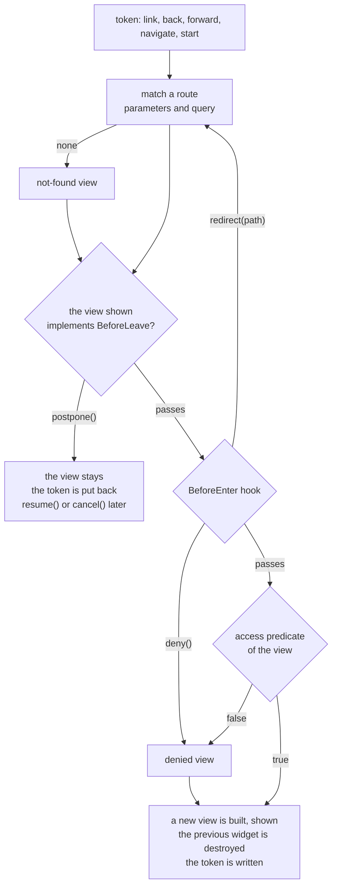

# Routing

The screens of an application are classes annotated `@Route`; a `Router` shows the one that matches the history
token (the URL fragment): when the page opens on a link, when the user goes back or forward, when a screen asks for
another. Why it is built so, and what it costs: [ADR-0020](../decisions/0020-routing.md). The `place` and `activity`
packages of 2.x keep working; a new application starts here.

## A first router

```java
@Route("orders/:id")
public class OrderView implements IsPWidget {

    private final PLabel label = Element.newPLabel();

    public OrderView(final RouteParameters parameters) {
        label.setText("Order " + parameters.getInt("id"));
    }

    @Override
    public PWidget asWidget() {
        return label;
    }
}

final PSimplePanel body = Element.newPSimplePanel();
PWindow.getMain().add(body);
final Router router = Router.builder(body)
    .views(OrdersView.class, OrderView.class)   // the application lists its views: nothing is scanned
    .start();                                   // shows the view of the current token

router.navigate(OrderView.class, Map.of("id", 42));   // #orders/42
router.navigate("orders?status=open");                // the same with a path
```

A view implements `IsPWidget`; its constructor takes the `RouteParameters`, or nothing. It can be package-private.
The router builds a new instance each time it enters the view.

## Paths

A path is segments separated by `/`: a literal (`orders`) or a named parameter (`:id`). The empty path is the root.

| Template | Matches | Not |
|---|---|---|
| `orders` | `orders` | `orders/42` |
| `orders/:id` | `orders/42`, `orders/a%20b` | `orders` |
| `orders/new` over `orders/:id` | `orders/new` goes to the first | |

At the same position a literal beats a parameter, the leftmost position first. Two views cannot have the same path;
`start()` throws `IllegalArgumentException` for that, and for a class without `@Route`. A view can have several paths,
the first is the one `navigate(View.class)` writes: `@Route({"orders", ""})` makes the list the root as well.

`RouteParameters` reads the path parameters and the query (`orders/42?status=open&page=2`) as one set; a path
parameter hides a query parameter of the same name. Values are percent-decoded.

```java
parameters.get("status", "all");       // String, with a fallback
parameters.getInt("id");               // throws IllegalArgumentException if absent or not an integer
parameters.getInt("page", 1);          // the fallback when absent or malformed
parameters.getLong("id", -1);
parameters.getBoolean("closed", false);
```

## Navigating

- `router.navigate(OrderView.class, Map.of("id", 42, "tab", "lines"))` fills the path with the parameters it names
  and writes the others in the query, sorted: `orders/42?tab=lines`. A null value leaves its parameter out.
- `router.navigate("orders/42")` takes a path, with its query if it has one.
- A link in the page works too: `Element.newPAnchor("Order 42", "#orders/42")`. The browser changes the fragment,
  the terminal tells the server, the router follows. Back and forward are the same.
- A view reaches its router with `parameters.router()`.
- Reloading the page, or opening its address elsewhere, shows the same view: the token is in the URL, and a server
  that stops gives it to the next one ([Deployment](deployment.md)).

The router writes the token with `newItem(token, false)` once the view is shown, and not when it is already the
token: the terminal sends nothing back.



## Before entering: let pass, redirect, deny

```java
Router.builder(body)
    .views(OrdersView.class, LoginView.class, AdminView.class)
    .beforeEnter(navigation -> {
        if (navigation.view() != LoginView.class && !signedIn(UIContext.get())) {
            navigation.redirect("login?from=" + navigation.token());
        }
    })
    .start();
```

The hook is called for each navigation to a view that matched a route, with its `view()`, `parameters()` and
`token()`. Doing nothing lets the navigation pass; `redirect(path)` goes to another path of the router, through the
hook again (eight redirections at most, then an `IllegalStateException`); `deny()` shows the denied view.

## Access

```java
.access(AdminView.class, ui -> ui.<Set<String>> getAttribute("roles").contains("admin"))
```

A `Predicate<UIContext>` per view, asked after the hook, each time the view is entered, so a role granted during
the session counts at the next navigation. The roles are the application's: an attribute of the `UIContext`, put
there at sign-in, or whatever the predicate can read. The router has no notion of role, and no dependency on Spring
or a security framework.

A navigation that is denied (by the predicate or by `deny()`) shows the denied view under the token that was asked,
so a deep link to a closed route shows it too. `denied(MyDeniedView.class)` sets the application's, built like
the other views; the default is a label, `Access denied: <token>`.

## Not found

A path that matches no route shows the not-found view, `notFound(MyNotFoundView.class)` or a label, `Not found:
<token>`. Its `RouteParameters` carry the token, so the view can say what was asked. An order that does not exist is
a view's own matter (`orders/99` matches `orders/:id`): the view says so.

## Before leaving: unsaved changes

A view that implements `BeforeLeave` is asked before the router leaves it.

```java
@Route("orders/:id/edit")
public class EditView implements IsPWidget, BeforeLeave {

    private boolean dirty;
    private Navigation.Postponed waiting;

    @Override
    public void beforeLeave(final Navigation navigation) {
        if (!dirty) return;                     // the navigation goes on
        waiting = navigation.postpone();        // the view stays
        confirm.setVisible(true);               // "Leave" calls waiting.resume(), "Stay" waiting.cancel()
    }
}
```

- `resume()` leaves the view and goes where the navigation was going, without asking again; `cancel()` stays. Both are
  called from a later event (a click on "Leave"); inside the hook they do nothing.
- Another navigation replaces a postponed one, and the old handle does nothing any more.
- When the navigation came from the browser's back or forward, the token is written back to the view's: the address
  bar tells the truth. The browser cannot cancel a back, so this adds an entry to its history.
- Closing the tab or reloading does not ask the view.

## A view that is left is destroyed

The router builds a view when it enters it and calls `onDestroy()` on its widget when it leaves it. A scheduler or a
listener stopped in a destroy listener stops with the view:

```java
final PScheduler.UIRunnable refresh = PScheduler.scheduleAtFixedRate(this::refresh, Duration.ofSeconds(1));
root.addDestroyListener(event -> refresh.cancel());
```

The same applies to a `Conflator` ([Streams](streams.md)): `root.addDestroyListener(event -> quotes.close())`. A view
whose construction throws leaves the screen and the token as they were.

## Sharing the token with the rest of the application

`base("routing")` makes the router own the tokens under `routing/` only: `#routing/orders/42` is the path
`orders/42`. A router started on a token outside its base goes to its root and writes it; a token outside its base
that comes later (the user went back to another page) is left alone. An application that uses the first segment of
the token for something else, as the showcase does for its tabs, takes the first segment and leaves the rest to the
router:

```java
final String page = token.split("[/?]", 2)[0];   // routing/orders/42 -> routing
```

The router stops when its panel is destroyed (the panel's `onDestroy()`, which a parent's destroy reaches), and stops
listening to the history. One panel, one router; a panel that holds a view with a router of its own is a nested
application.

## Testing

A router is tested with `PSuite` ([Testing](testing.md)): the browser's back is `fireHistoryChanged(token)`, a reload
is a token written before the router starts.

```java
public class OrdersRoutingTest extends PSuite {

    @Test
    public void aDeepLinkOpensTheOrder() {
        final PHistory history = UIContext.get().getHistory();
        history.newItem("orders/42", false);                       // what a reload replays
        final PSimplePanel body = Element.newPSimplePanel();
        Router.builder(body).views(OrdersView.class, OrderView.class).start();
        assertEquals("Order 42", ((PLabel) body.getWidget()).getText());
        history.fireHistoryChanged("orders");                      // the browser's back
        assertEquals("Orders", ((PLabel) body.getWidget()).getText());
        body.onDestroy();                                          // stops the router
    }
}
```

Destroy the panel at the end of each test: a router that stays keeps listening to the context's history.

## The showcase

The Routing page is a small application under the token `routing`: a list of orders filtered by the query, a detail
`orders/:id` with a scheduler that stops when it is left, an edit form that postpones the navigation, an `admin` route
denied until the role is granted, and a link to a page that does not exist. Its code is the page's own source
(`RoutingPage.java`), and `sample/tests/routing.spec.js` drives it in the browser.
