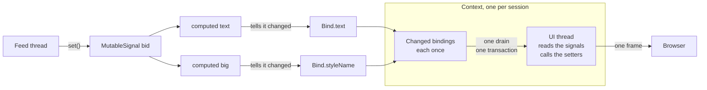

# Signals

A value shown in several places is a `Signal`: the application sets it once, every widget bound to it follows, on its
UI thread, once per flush. A computed signal derives from others. Why, and what was measured:
[ADR-0019](../decisions/0019-signals.md).

```java
final MutableSignal<Double> bid = Signal.of(1.0850);
final Signal<String> text = Signal.computed(() -> String.format("%.4f", bid.get()));
final Signal<Boolean> big = Signal.computed(() -> bid.get() > 1.1);

Bind.text(price, text);              // a PLabel
Bind.styleName(price, "alert", big); // on while the signal is true

feed.onQuote(quote -> bid.set(quote.bid())); // any thread, as often as it likes
```

## Signals

| | |
|---|---|
| `Signal.of(initial)` | A `MutableSignal<T>`: `get()`, `set(value)`, `update(fn)` |
| `Signal.computed(() -> …)` | A `Signal<T>` derived from the signals its function reads with `get()` |
| `get()` | The current value, from any thread |
| `set(value)` | Replaces the value, from any thread; an equal value (`equals`) does nothing |
| `update(fn)` | Replaces the value with a function of it, atomically; `fn` must not block |

- A computed signal cannot be set: it is a `Signal`, not a `MutableSignal`.
- A signal belongs to the application, not to a session: set it once, bind it in every session that shows it.
- `update` and the function of a computed signal run on the calling thread, inside the signal's own lock for
  `update`: they read and compute, they do not call out.

## Computed signals

A computed signal follows what its function reads, the last time it ran: a branch not taken is not followed.

```java
final Signal<String> label = Signal.computed(() -> showBid.get() ? bid.get() + "" : ask.get() + "");
```

- It is lazy: nothing runs until it is read, and the value is kept until an input changes.
- It runs once per read after any number of changes: ten sets of `bid` between two flushes are one computation.
- No glitch: a signal reading `a`, one derived from `a` and one derived from both is computed once per change of `a`,
  never from a mix of old and new values.
- A computation giving a value equal to the previous one does not change what reads it: they do not recompute.
- A computation that throws is run again at the next read; a binding on it logs the failure and follows the next
  change of what it read.
- A signal reading itself throws `IllegalStateException`.



## Bindings

Each `Bind` method is called on the UI thread of the widget's context, shows the signal's value at once, and returns a
`Binding`.

| Method | Follows |
|---|---|
| `Bind.text(PLabel, Signal<String>)`, `Bind.text(PButton, …)` | The text |
| `Bind.visible(PWidget, Signal<Boolean>)` | `setVisible` |
| `Bind.enabled(PFocusWidget, Signal<Boolean>)` | `setEnabled` |
| `Bind.styleName(PWidget, name, Signal<Boolean>)` | The style name, on while true |
| `Bind.value(box, MutableSignal<T>)` | The value of a box, in both directions |
| `Bind.children(panel, Signal<List<T>>, key, row)` | The children of a panel, kept by key |
| `Bind.to(widget, signal, (w, v) -> …)` | Any other property: `Bind.to(label, signal, PLabel::setTitle)` |

```java
final MutableSignal<String> quantity = Signal.of("100");
final PTextBox box = Element.newPTextBox();
Bind.value(box, quantity);                    // typing sets the signal, setting the signal fills the box
Bind.text(echo, Signal.computed(() -> "Quantity " + quantity.get()));
```

The terminal sends a text box's value on change (Tab or Enter), as it does for a value change handler.

### Lists

```java
final MutableSignal<List<Position>> positions = Signal.of(List.of());
Bind.children(rows, positions, Position::id, position -> {
    final PFlowPanel row = Element.newPFlowPanel();
    final PLabel pnl = Element.newPLabel();
    Bind.text(pnl, position.pnlText());        // the item holds its signals
    row.add(pnl);
    return row;
});
positions.set(List.copyOf(next));
```

- `row` runs once per key. A widget is kept while an item has its key, moved when the order changes (the terminal
  moves the same element), and destroyed, with its bindings, when the key is gone.
- A widget does not follow its item's changes: it follows the signals the item holds. An item that is a plain value
  keeps its widget, and the value is not shown again: put what changes in a signal.
- The list is replaced, never changed in place; two items with one key throw `IllegalArgumentException`. The panel
  belongs to the binding.

## Threads and flushes

- A signal is set from any thread, a feed's included. `set` takes a lock for its own value and adds the bindings to
  its contexts' lists; it never waits for a client.
- A context applies its changed bindings in one drain: one transaction, one flush. A binding changed a hundred times
  since the previous drain runs once and reads the latest value. A burst of sets is at most one update of each bound
  property.
- The drain is the context's `Conflator` ([Streams](streams.md)): one at a time, on a virtual thread, nothing applied
  while the connection is lost ([Reconnection](reconnection.md)), the latest values after it.
- A signal set on the UI thread (the user's input) reaches the other widgets in the next drain.

### Pacing

```java
Bind.configure(Duration.ofMillis(50), null); // at most 20 flushes a second; null: a virtual thread per drain
```

Once per context, on its UI thread, before its first binding (the entry point's first line); afterwards it throws
`IllegalStateException`. The showcase does it so that 10 000 signal sets a second reach the browser 20 times a second.

## Lifecycle

- A binding ends when its widget is destroyed, or its context is. Nothing to unsubscribe: a signal that outlives
  sessions holds none of their widgets, and a computed signal nothing follows is held by none of its sources.
- `Binding.close()` ends it sooner; the widget keeps what it shows.
- A widget in no window of its context is not destroyed with it: its bindings end with the context all the same.

## Signal, `Conflator`, event

| The value… | Use |
|---|---|
| is shown in several places, or derived from others | a `Signal` |
| replaces the previous one for a key, shown in one place by a setter | a [`Conflator`](streams.md) |
| counts on its own: a fill, an alert, a row added | `UIContext.execute`, every one |
| is something the user did | a handler, the [EventBus](event-bus.md) |

A signal conflates like a `Conflator`: the values set between two flushes are replaced by the latest. It is for values
whose latest state is what the screen shows.

## Cost

Per updated cell, 60 of 240 labels per flush, protocol 4 (`./gradlew :ponysdk:bench -Pbench.args="v4 signals 4"`):

| | wire | CPU | allocation |
|---|---|---|---|
| `setText` in one `execute` | 3.9 B | 35 ns | 0.4 B |
| signal set, label bound | 3.9 B | 53 ns | 1.3 B |
| signal set, label bound to a computed signal | 3.9 B | 80 ns | 1.3 B |

The wire is the same as a setter's. The CPU is higher: a setter is nearly free, and a signal adds its lock, its list and
its flag. The showcase's Signals page shows a feed of 10 000 sets a second, a computed total, a text box bound both ways
and a keyed list, with the code from its source.
