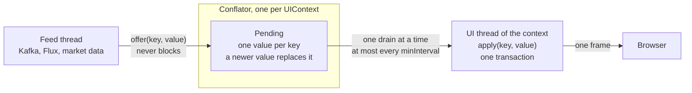
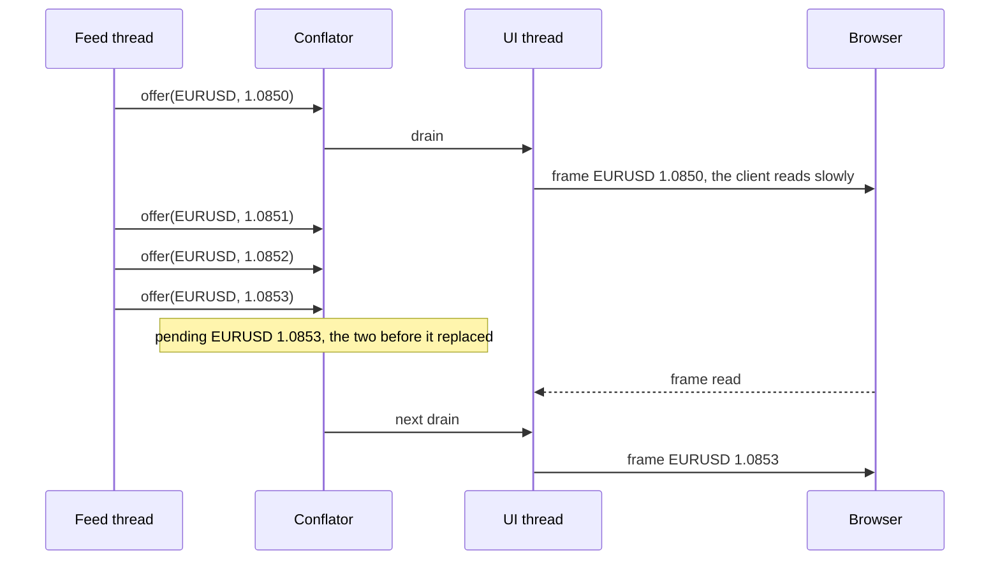
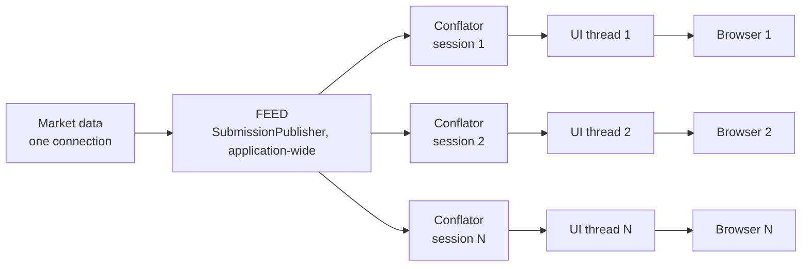

# Streams

A screen that shows values another thread produces (a Kafka consumer, a Reactor `Flux`, a market data callback)
goes through a `Conflator`: the thread offers each value, the screen gets the latest value of each key, one flush at
a time. Why, and what was measured: [ADR-0013](../decisions/0013-conflated-streams.md).

```java
final Conflator<String, Quote> quotes = Conflator.of(uiContext,
    (instrument, quote) -> rows.get(instrument).setText(quote.bid()));

feed.onQuote(quote -> quotes.offer(quote.instrument(), quote)); // the feed's thread
```

## The path of a value



- `offer(key, value)` replaces the key's pending value and returns. It returns false once the conflator is closed.
- A drain applies the pending values on the context's UI thread, in one transaction: one frame for all the keys that
  changed since the previous drain, in the order they first came.
- While the connection is lost and the context waits for its client ([Reconnection](reconnection.md)), nothing is
  applied: the first drain after the reconnection shows the latest values.
- The context's destroy closes the conflator; `close()` closes it sooner, for a screen the user left.

## A slow client costs the feed nothing



The drain waits for the client, the feed does not: memory stays at one value per key, whatever the client's pace.
On the showcase's Streams page, a feed of 10 000 quotes a second over 24 instruments gives about 400 values applied a
second: 96 % of the quotes are replaced before being shown, and the screen still shows the latest of each.

## Conflate, or apply every one?

Conflating drops values. Which values can be dropped is the application's to say, so a conflator is explicit, per
stream, never applied to every update behind the application's back.

| The value… | Examples | Use |
|---|---|---|
| replaces the previous one: only the latest is worth showing | price, P&L, position, connection state, progress | a `Conflator` |
| counts on its own: losing one is a bug | fill, order status, row added, alert, log line | `UIContext.execute`, every one, in order |
| depends on another one shown before it | a row added, then filled | `UIContext.execute`, in one runnable |

A key is what the screen shows once: the instrument of a price cell, the account of a P&L. Two values of one key
replace each other; values of different keys never do.

## What is already done for every session

| Without writing anything | With a `Conflator` |
|---|---|
| In one transaction, the last value of a property is the only one sent | Across transactions: the values of a key offered between two drains are applied once |
| A slow client does not hold the thread that writes to it beyond a queue of 4 buffers | The feed is never held, whatever the client's pace |
| With transparent reconnection, a suspended context keeps what it writes for the client | Nothing applied while suspended, the latest values after it |

## One feed, every session

The feed runs once for the application; each session subscribes its own conflator to it. A `SubmissionPublisher` (or
any `Flow.Publisher`) does the fan-out:



```java
// Application-wide, once
static final SubmissionPublisher<Quote> FEED = new SubmissionPublisher<>();
marketData.onQuote(FEED::submit);

// In each session's EntryPoint
FEED.subscribe(Conflator.<String, Quote> builder(uiContext, this::show)
        .minInterval(Duration.ofMillis(50))
        .build()
        .subscriber(Quote::instrument));
```

- Each session gets the latest values at its own client's pace: a slow browser drops more values, it never slows
  the feed or another session.
- A session that ends closes its conflator with its context, and that cancels its subscription: nothing to
  unsubscribe by hand.
- The subscriber requests without limit, since offering never blocks. The publisher's completion or error closes the
  conflator. A Reactor `Flux` subscribes through `JdkFlowAdapter.publisherToFlowPublisher(flux)`.

## Options

```java
Conflator.<String, Quote> builder(uiContext, apply)
    .minInterval(Duration.ofMillis(50)) // at most 20 drains a second; none by default
    .executor(executor)                 // where the drains run; a virtual thread each by default
    .build();
```

## Counting

`getOffered()` and `getApplied()` count values since the creation: their difference is what was replaced before
being shown. The showcase's Streams page shows them per second, with the code from its source.
